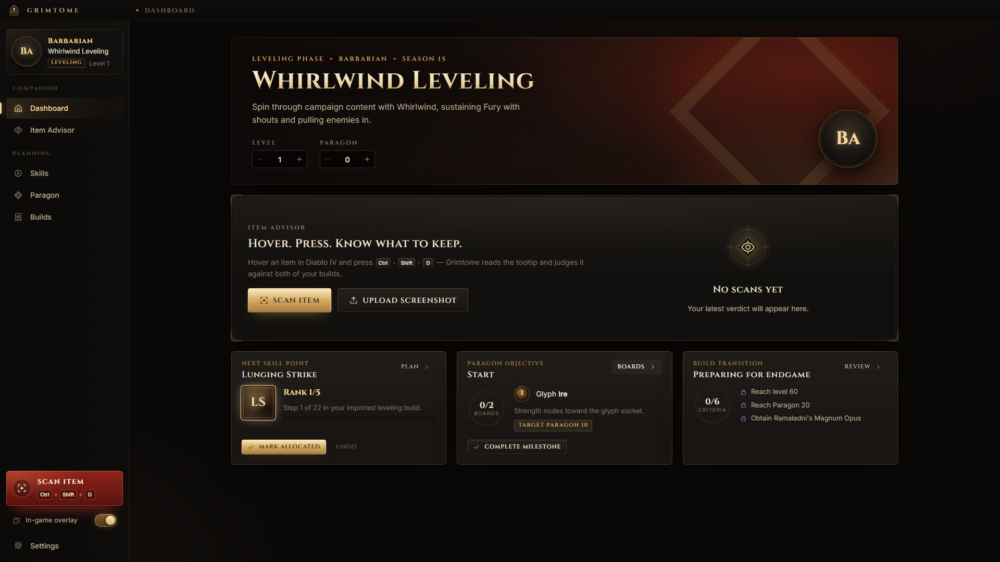
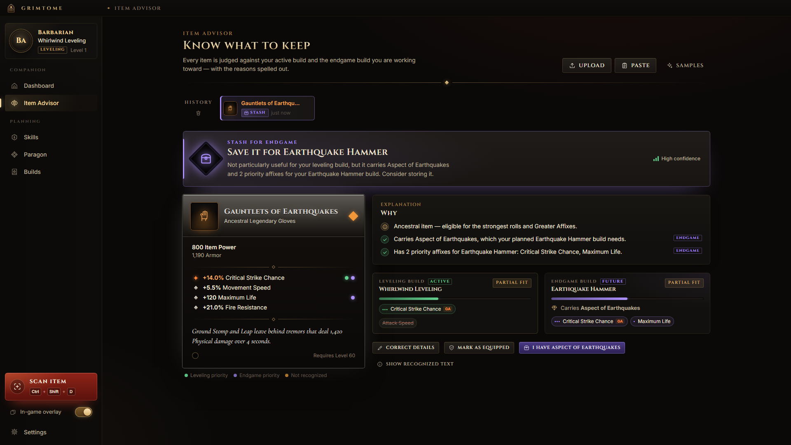
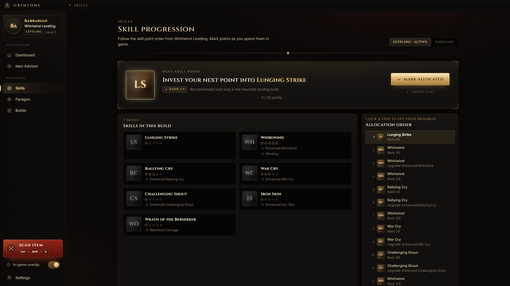

# Grimtome

**A Diablo IV build companion for Windows.** Hover an item in game, press a hotkey, and Grimtome reads the tooltip and tells you whether to equip it, keep it, stash it for your endgame build or salvage it — with the reasons spelled out. It also walks you through your skill point order, your Paragon boards and the moment to switch from your leveling build to your endgame build.

> Unofficial fan project. Not affiliated with, endorsed or sponsored by Blizzard Entertainment. Diablo is a trademark of Blizzard Entertainment, Inc.



| Item Advisor | Skills |
| --- | --- |
|  |  |

_Screenshots show the default look, which ships with the app. If you import the textures from your own Diablo IV installation (optional), the whole interface switches to the game's native buttons, frames, tooltips and icons on your machine. Those textures are never included in this repository or the installer._

## What it does

- **Two builds at once.** You follow a leveling build now and an endgame build you are working toward. Every verdict considers both, so an item your endgame build needs is flagged "Stash for endgame" even while you are leveling.
- **Item Advisor.** Global hotkey capture (or screenshot upload, or pasted tooltip text) → Windows OCR → tooltip parser → deterministic, explainable verdict: _Upgrade candidate_, _Keep_, _Stash for endgame_, _Salvage / sell_ or _Needs review_. Low-confidence reads are never guessed; you can correct any recognized line.
- **Skill and Paragon guidance.** Next skill point, rank and upgrade order; Paragon board path and glyph milestones.
- **Build transition.** Tracks readiness criteria (level, Paragon, required uniques and aspects) and switches recommendations when you move to your endgame build — or back.
- **In-game overlay.** A small always-on-top panel that shows the latest verdict without taking focus from the game, with optional click-through.
- **Local-first.** No account, no cloud, no telemetry. Nothing leaves your PC.

## Safety

Grimtome only looks at what is on your screen, like a screenshot would. It does **not** read game memory, inject code or DLLs, modify game files, intercept network traffic, automate gameplay or inventory actions, or try to hide from anti-cheat software. See [docs/COMPLIANCE.md](docs/COMPLIANCE.md).

## Install (Windows 10/11, x64)

1. Download `Grimtome_<version>_x64-setup.exe` (or the `.msi`) from the [latest release](https://github.com/ldallacqua/grimtome/releases). A portable `grimtome-<version>-portable.exe` (no install) is attached as well.
2. Run it. The installer is **not code-signed**, so Windows SmartScreen will warn "Windows protected your PC" — choose _More info → Run anyway_. Verify the file against `SHA256SUMS.txt` from the release if you want to be sure it is the published build.
3. It installs per user (no administrator rights). Microsoft Edge WebView2 is required; it is preinstalled on Windows 11 and the installer fetches it if missing.

Uninstall from _Settings → Apps_. Your data lives in `%APPDATA%\app.grimtome.desktop` (builds, progress, settings) and `%LOCALAPPDATA%\Grimtome` (optional imported game textures); delete those folders to remove everything.

## Using Grimtome

### Load your builds

Open **Builds → Import**:

- **Paste from a guide** — copy the skill order, gear, aspects and Paragon sections from the guide you follow (Maxroll or any site) and paste them. Grimtome recognizes skills, aspects, uniques, affixes, boards and glyphs by name and shows a draft for review before saving. Recognition is best with game assets imported (the local catalog provides every name).
- **Maxroll link** — stored as the build's source so you can reopen the guide. Grimtome does **not** download Maxroll pages (their terms and robots.txt disallow automated access); paste the text instead.
- **JSON** — Grimtome's own build file format (`grimtome.builds`, versioned and validated). Use _Export JSON_ to back up or share.
- **Sample builds** — a Barbarian Whirlwind leveling build and an Earthquake Hammer endgame build, to try everything out.

### Scan items

- **In game:** run Diablo IV in _Windowed_ or _Borderless (Windowed Fullscreen)_ mode, hover an item and press **Ctrl+Shift+D**. The verdict appears in the overlay and the Item Advisor. If the game shows an "Equipped" comparison tooltip, it is read too.
- **Scan button:** Grimtome minimizes, waits 3 seconds for you to hover an item, captures, and comes back.
- **Upload / paste:** drop a screenshot or paste tooltip text in the Item Advisor.

Capture modes (Settings → Capture): _Smart_ (finds the tooltip near the cursor), _Cursor area_ and _Fixed region_. OCR uses the language packs installed in Windows (Settings → Time & language → Language).

### Overlay

Toggle with **Ctrl+Shift+O**, or from the sidebar. **Ctrl+Shift+X** toggles click-through so mouse clicks go to the game. Opacity, compact/expanded mode, auto-hide and "show on scan" are in Settings → Overlay. Drag it by its top bar. All hotkeys can be changed in Settings → Hotkeys.

### Optional: use the game's own textures

Settings → **Game assets** → _Import_. Grimtome finds your Diablo IV installation (Steam installs are supported; Battle.net installs are detected but their storage format is not supported yet), shows what it will do and asks for consent. It then reads the game's files read-only and writes decoded textures and names to `%LOCALAPPDATA%\Grimtome\assets\current` on your PC (≈1,900 images, a few seconds). The interface switches to the native look immediately; _Clear_ removes the cache. See [docs/ASSETS.md](docs/ASSETS.md) and the gray-area note in [docs/COMPLIANCE.md](docs/COMPLIANCE.md).

## Development

Requirements: Windows 10/11, Node 24, pnpm 12, Rust (stable, MSVC), Visual Studio Build Tools (C++).

```bash
pnpm install
pnpm dev            # web UI at http://localhost:1420 (no capture; OCR uses recorded samples)
pnpm app:dev        # desktop app with hot reload
pnpm app:build      # installers in target/release/bundle
```

Checks: `pnpm lint`, `pnpm format:check`, `pnpm typecheck`, `pnpm test`, `pnpm test:e2e`, `pnpm test:visual`, `pnpm test:desktop`, `pnpm check:assets`, `cargo clippy --workspace --all-targets`, `cargo test --workspace`. See [docs/TESTING.md](docs/TESTING.md).

Documentation: [Architecture](docs/ARCHITECTURE.md) · [Assets](docs/ASSETS.md) · [Compliance](docs/COMPLIANCE.md) · [Research](docs/RESEARCH.md) · [Testing](docs/TESTING.md) · [Decisions](docs/adr) · [Checklist](docs/CHECKLIST.md) · [Agent guide](AGENTS.md)

## License

[MIT](LICENSE) for Grimtome's code and original artwork. Game names, item names and imported game textures belong to Blizzard Entertainment and are not covered by this license.
